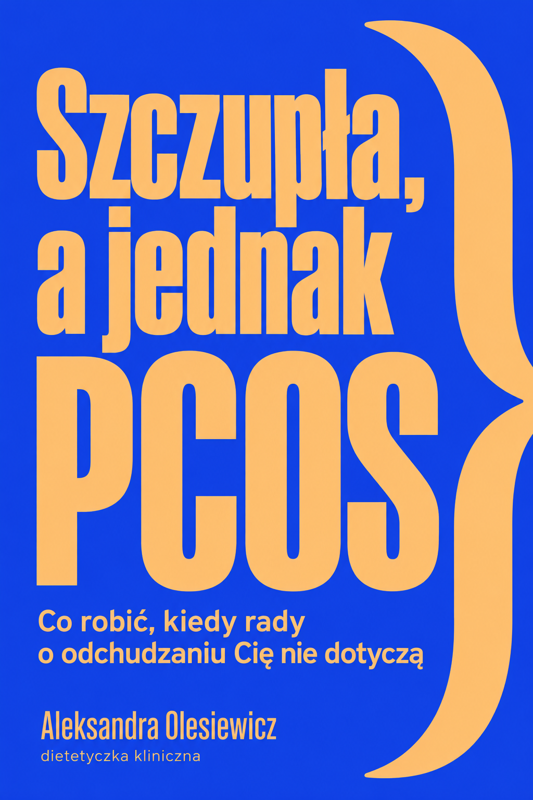
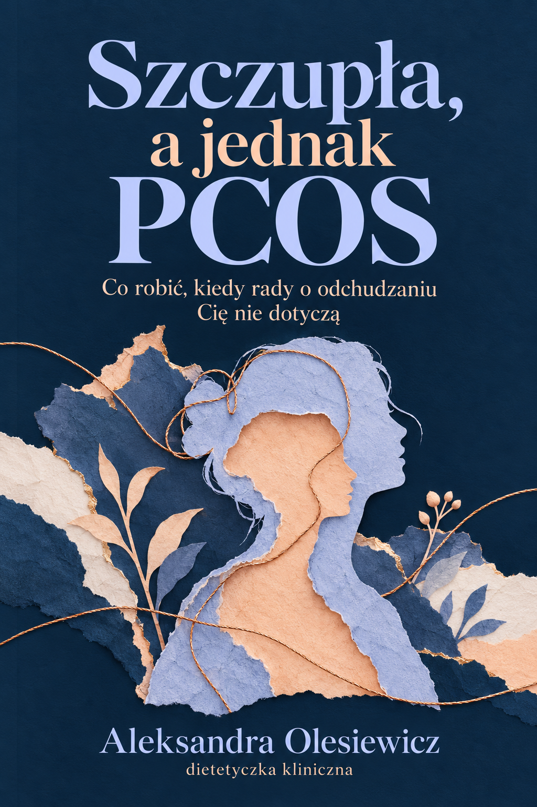
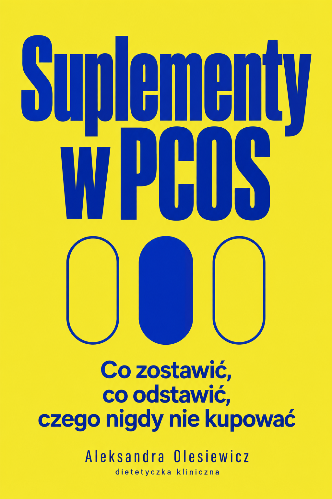
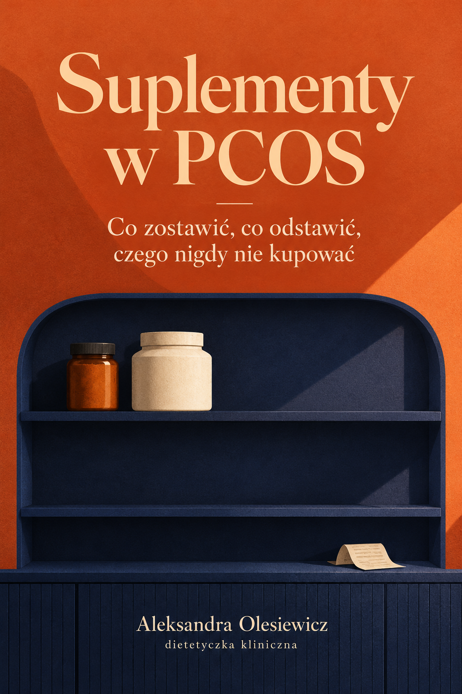

# Propozycje okładek e-booków, 17.10.2026

Aktualizacja po wyborze: użytkownik zaakceptował wszystkie ilustracje C.
Podpis zmieniono na „Aleksandra Olesiewicz-Zawłodzka”. Finalne pliki:
[Szczupła](szczupla-c-author-v2.webp), [Badania](badania-c-author-v2.webp),
[Suplementy](suplementy-c-author-v2.webp). PNG zachowano obok WebP.
[Prompty edycji](author-edits.json), [rejestr Sanity](cms-change.json)
i [stan przed przypisaniem](cms-before.json).
Obrazy opublikowano w Sanity 17.10.2026. Poprawkę renderowania kart
wdrożono przez [PR 126](https://github.com/zawlodzki/nowa-strona-ola/pull/126).
Produkcja run 39043923827 SUCCESS, wersja Workera
82361138-53a7-470f-929c-a73e5ef1e734. Obejrzano trzy nowe okładki na stronie.
Poniższy opis dziewięciu propozycji dokumentuje etap przed wyborem.

Status: dziewięć propozycji do wyboru, po trzy dla każdego e-booka.
Wygenerowane osobnymi wywołaniami wbudowanego `image_gen`. Nie podmieniono
okładek na stronie ani w Sanity.

Źródło briefu: polecenie użytkownika z 17.10.2026 i trzy wskazane pliki
`EBOOK_Szczupla_a_jednak_PCOS.md`, `EBOOK_Badania_w_PCOS.md`,
`EBOOK_Suplementy_w_PCOS.md` w FIRMA/04_OFERTA_I_SPRZEDAZ/PRODUKTY_CYFROWE.
Z plików zaczerpnięto temat, tytuł, podtytuł i podpis autorki. Uwagi redakcyjne
wewnątrz materiałów potraktowano jako treść źródłową, bez wykonywania ich zaleceń.
Pełny tytuł e-booka o badaniach pochodzi z nagłówka treści, nie skróconej nazwy pliku.

| E-book                          | A. Fotografia                     | B. Typografia                     | C. Ilustracja                     |
| ------------------------------- | --------------------------------- | --------------------------------- | --------------------------------- |
| Szczupła, a jednak PCOS         |      |      |      |
| Badania w PCOS, które mają sens |        |        |        |
| Suplementy w PCOS               |  |  |  |

A wykorzystuje światło, materialne obiekty i szeryfowe tytuły.
B wykorzystuje duże wąskie litery oraz nasycone jednolite kolory.
C wykorzystuje papierowe kolaże i ilustracje związane z tematem książki.
Każdy kierunek ma paletę odrębną od bieli, wiśni i matcha strony 3a.

Propozycja autora projektów: B jako spójna seria o mocnym kontraście i dużych
tytułach. Przy wyborze osobno: Szczupła C, Badania A, Suplementy C.
To rekomendacja, nie decyzja użytkownika.
Suplementy A ma skojarzenia z reklamą preparatu, słabiej oddaje krytyczny audyt.
Badania B ma mniej wyraźne odstępy przy dolnym wierszu tytułu, do dopracowania
przy wyborze. Przed finalizacją potrzebny odbiór składu i czytelności miniatur
w rzeczywistym układzie strony.

Wszystkie PNG mają 1024×1536 px. Obejrzano dziewięć wygenerowanych okładek,
porównano tytuły, podtytuły, autorstwo i palety. Pełne oryginalne prompty
i ścieżki źródłowe: [prompts.json](prompts.json).
Napisy są częścią wygenerowanego obrazu, brak edytowalnego pliku składu.

Istniejące pole `ebook.cover.image` przechowuje obraz, `ebook.cover.alt`
jego opis, hotspot i crop należą do obrazu. Schemat nie wymaga nowej palety.
Landing `Ebook3a` obsługuje obraz; katalog `EbookCollection3a` nadal renderuje
`BookCover`, więc samo przesłanie plików do CMS nie zastąpi okładek wszędzie.
Przed wdrożeniem trzeba prześledzić wszystkie miejsca ekspozycji i dopiąć
renderowanie pliku. Docelowe proporcje należy sprawdzić bez obcinania napisów.

W tej sesji zmieniono tylko propozycje i dokumentację. Nie uruchamiano aplikacji
ani `npm run verify`. Odbiór desktop, mobile, 320 px, klawiatury, zoomu 200%
i reduced motion pozostaje do wdrożenia wybranego zestawu.
